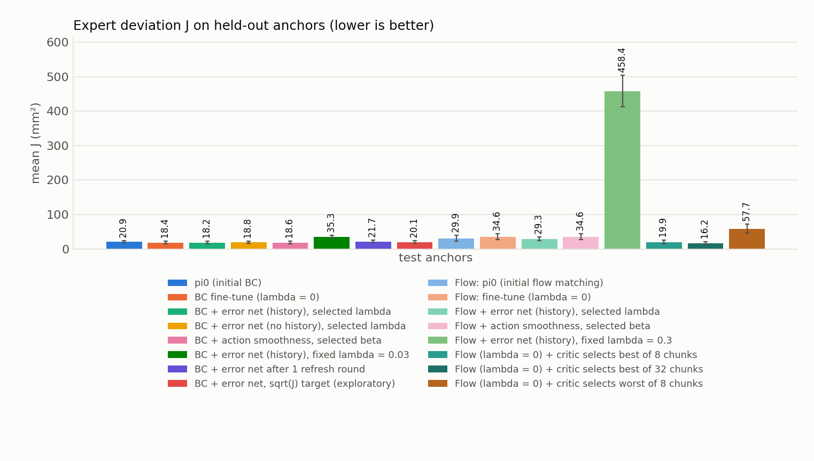
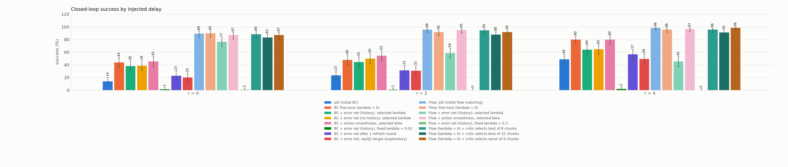
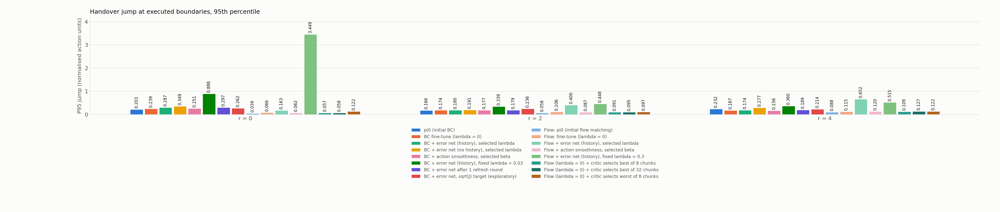

# Chunk Trajectory Error: ManiSkill PickCube-v1 results

Generated by `scripts/08_report.py`. Host: Linux-6.18.44-fc-v378-x86_64-with-glibc2.39; Python 3.10.20; PyTorch 2.14.1+cu130 (CUDA available: False); ManiSkill 3.0.1; SAPIEN 3.0.3; simulation `physx_cpu`, one environment.

Chunk settings: H=20, e=5, L=15, K=10, train delay r=0. Seed 17. One training run per variant (no seed repeats).

## 1. Data and replay

- Demonstrations: 600 episodes in the file, the first 600 used (`audit.num_episodes`), source `motionplanning`; split by episode into 400 / 100 / 100 (train / val / test).
- Provenance: Generated locally with ManiSkill's official motion-planning solution (python -m mani_skill.examples.motionplanning.panda.run -e PickCube-v1 -n 600 --only-count-success; 600 successful episodes, one failed plan skipped), because the Hugging Face download used by mani_skill.utils.download_demo was blocked on the audit host. Swap in the downloaded official trajectory.h5/.json and rerun to audit the published file.
- Replay audit (60 train anchors, tolerance 1 mm): `snapshot_restore_same_env` max 0.5386 mm (pass); `snapshot_restore_after_reset` max 0.5386 mm (pass); `hdf5_state_restore` max 0.5386 mm (pass); `prefix_replay` max 0.0033 mm (pass); `snapshot_branch_repeatability` max 0.0000 mm (pass); `control_shift_one_frame` max 13.9624 mm (pass).
- Branches, train: 1600 anchors, 12800 branches, 0 aborted, 0 candidates clipped at the action box. expert 1600 (median sqrt(J) 0.00 mm), expert_perturbed 3200 (median sqrt(J) 9.27 mm), policy 1600 (median sqrt(J) 3.19 mm), policy_perturbed 6400 (median sqrt(J) 10.30 mm).
- Branches, val: 300 anchors, 2400 branches, 0 aborted, 0 candidates clipped at the action box. expert 300 (median sqrt(J) 0.00 mm), expert_perturbed 600 (median sqrt(J) 8.68 mm), policy 300 (median sqrt(J) 3.84 mm), policy_perturbed 1200 (median sqrt(J) 10.66 mm).
- Branches, test: 300 anchors, 2400 branches, 0 aborted, 0 candidates clipped at the action box. expert 300 (median sqrt(J) 0.00 mm), expert_perturbed 600 (median sqrt(J) 10.27 mm), policy 300 (median sqrt(J) 3.65 mm), policy_perturbed 1200 (median sqrt(J) 10.48 mm).

## 2. Error network (held-out branches)

| Variant | Split | MAE (m²) | Constant-mean MAE (m²) | MAE of sqrt(J) (mm) | Pearson | Within-anchor Spearman | Best-candidate match |
|---|---|---:|---:|---:|---:|---:|---:|
| history | val | 7.576e-05 | 3.249e-04 | 3.03 | 0.959 | 0.853 | 0.45 |
| history | test | 7.208e-05 | 3.427e-04 | 2.91 | 0.972 | 0.880 | 0.55 |
| history_fullobs | val | 7.298e-05 | 3.249e-04 | 3.05 | 0.967 | 0.858 | 0.56 |
| history_fullobs | test | 7.114e-05 | 3.427e-04 | 2.90 | 0.972 | 0.882 | 0.57 |
| history_r1 | val | 7.543e-05 | 3.083e-04 | 3.04 | 0.962 | 0.874 | 0.52 |
| history_r1 | test | 7.313e-05 | 3.272e-04 | 2.97 | 0.971 | 0.888 | 0.57 |
| history_sqrt | val | 7.908e-05 | 3.249e-04 | 2.48 | 0.944 | 0.908 | 0.79 |
| history_sqrt | test | 7.757e-05 | 3.427e-04 | 2.33 | 0.955 | 0.924 | 0.75 |
| nohist | val | 9.177e-05 | 3.249e-04 | 3.63 | 0.954 | 0.833 | 0.46 |
| nohist | test | 9.096e-05 | 3.427e-04 | 3.59 | 0.960 | 0.847 | 0.48 |

Mean predicted vs. true J on test, by candidate type (m²): this shows the resolution of each network near J = 0.

| Variant | expert (true 0) predicted | policy true | policy predicted |
|---|---:|---:|---:|
| history | 3.23e-05 | 2.09e-05 | 4.08e-05 |
| history_fullobs | 3.40e-05 | 2.09e-05 | 4.07e-05 |
| history_r1 | 3.09e-05 | 2.09e-05 | 3.86e-05 |
| history_sqrt | 9.12e-06 | 2.09e-05 | 2.11e-05 |
| nohist | 4.10e-05 | 2.09e-05 | 4.84e-05 |

## 3. Gradient audit

- Parameter gradients from the surrogate alone: policy gradient norm 1.573e+01, finite True, non-zero True; error-network parameters without gradient True. Gate: pass.
- Step size: L2 norm over the K x 3 continuous action entries (normalised units), chosen on validation per candidate type from [0.02, 0.05, 0.1, 0.2, 0.4]; gripper channel masked.

| Test candidates | Step | n | Mean J before (m²) | ΔJ gradient step (m²) [95% CI] | ΔJ random step (m²) [95% CI] | Gradient − random (m²) [95% CI] | Relative ΔJ (gradient) | Gradient lowers J | Gate |
|---|---:|---:|---:|---:|---:|---:|---:|---:|---|
| policy | 0.05 | 300 | 2.090e-05 | -3.925e-06 [-5.59e-06, -2.31e-06] | 1.925e-06 [1.24e-06, 2.63e-06] | -5.851e-06 [-7.80e-06, -4.04e-06] | -18.8% | 59% | pass |
| policy_perturbed | 0.2 | 300 | 3.662e-04 | -1.789e-04 [-2.22e-04, -1.38e-04] | 3.358e-05 [1.75e-05, 4.80e-05] | -2.125e-04 [-2.54e-04, -1.72e-04] | -48.9% | 59% | pass |
| expert_perturbed | 0.2 | 300 | 3.758e-04 | -1.677e-04 [-2.13e-04, -1.24e-04] | 2.680e-05 [1.32e-05, 3.97e-05] | -1.945e-04 [-2.40e-04, -1.51e-04] | -44.6% | 57% | pass |

Validation, policy samples only (mean ΔJ of the gradient step / of the random step, m²): step 0.02: -4.59e-06 / 5.45e-07; step 0.05: -4.74e-06 / 2.50e-06; step 0.1: 1.27e-05 / 8.89e-06; step 0.2: 1.14e-04 / 3.37e-05; step 0.4: 5.75e-04 / 1.30e-04.

Direction gate (on test, at the step size chosen on val for that candidate type: 95% CI of delta_J_grad below 0 AND 95% CI of (grad - rand) below 0; the policy-sample row decides the gate): **pass**.

## 4. Policy fine-tuning

All variants start from the same pi0 and use the same data, batches, learning rate and 5000 update steps. The weight is chosen on validation by the simulator-recomputed J of the policy's own chunk.

Flow-matching policy class (`*_flow` rows): 633936 parameters, 8 Euler steps per chunk; pi0_flow best val flow-matching loss 0.0346, val MSE of one sampled chunk 0.01277 (MLP pi0 val BC loss 0.00750); pi0_flow val closed-loop r = 0: 29/30 (MLP pi0: 5/30). Flow variants start from pi0_flow; their imitation term is the flow-matching loss and the auxiliary term acts on a sampled chunk. `Val BC loss` for flow rows is the MSE of one sampled chunk.

| Variant | Weights tried (val mean J, m²) | Selected | Val BC loss | Grad-norm ratio auxiliary / imitation (last log) |
|---|---|---:|---:|---:|
| BC fine-tune (lambda = 0) | 0: 2.78e-05 | 0 | 0.00771 | 0.00 |
| BC + error net (history), selected lambda | 0.001: 2.69e-05, 0.003: 2.96e-05, 0.01: 3.20e-05, 0.03: 4.32e-05, 0.1: 7.01e-05, 0.3: 1.37e-04, 1: 2.57e-04 | 0.001 | 0.00773 | 0.21 |
| BC + error net (no history), selected lambda | 0.001: 2.64e-05, 0.003: 2.77e-05, 0.01: 3.39e-05, 0.03: 4.86e-05, 0.1: 8.80e-05, 0.3: 1.45e-04, 1: 2.50e-04 | 0.001 | 0.00775 | 0.22 |
| BC + action smoothness, selected beta | 0.1: 2.78e-05, 0.3: 2.88e-05, 1: 2.87e-05 | 0.1 | 0.00769 | 0.05 |
| BC + error net after 1 refresh round | 0.003: 2.83e-05, 0.01: 3.29e-05, 0.03: 4.55e-05, 0.1: 7.41e-05 | 0.003 | 0.00778 | 0.44 |
| BC + error net, sqrt(J) target (exploratory) | 0.003: 2.66e-05, 0.01: 2.67e-05, 0.03: 2.96e-05, 0.1: 3.56e-05, 0.3: 4.88e-05 | 0.003 | 0.00777 | 0.33 |
| Flow: fine-tune (lambda = 0) | 0: 4.33e-05 | 0 | 0.01272 | 0.00 |
| Flow + error net (history), selected lambda | 0.001: 4.10e-05, 0.003: 3.91e-05, 0.01: 3.72e-05, 0.03: 3.61e-05, 0.1: 4.28e-05, 0.3: 4.57e-04, 1: 3.70e-03 | 0.03 | 0.01279 | 0.10 |
| Flow + action smoothness, selected beta | 0.1: 4.33e-05, 0.3: 4.34e-05, 1: 4.34e-05 | 0.1 | 0.01272 | 0.00 |

## 5. Expert deviation on held-out test anchors (r = 0)

J is recomputed in simulation: the policy's chunk tail and the expert's actions both start from the same restored state and run K steps.

| Policy | Mean J (m²) [95% CI] | Mean sqrt(J) (mm) | Paired ΔJ vs same-class fine-tune, lambda = 0 (m²) [95% CI] | Relative |
|---|---:|---:|---:|---:|
| pi0 (initial BC) | 2.091e-05 [1.78e-05, 2.48e-05] | 4.01 | 2.469e-06 [7.59e-07, 4.13e-06] | +13.4% |
| BC fine-tune (lambda = 0) | 1.844e-05 [1.52e-05, 2.26e-05] | 3.63 | – | – |
| BC + error net (history), selected lambda | 1.820e-05 [1.52e-05, 2.21e-05] | 3.65 | -2.405e-07 [-1.47e-06, 9.48e-07] | -1.3% |
| BC + error net (no history), selected lambda | 1.878e-05 [1.57e-05, 2.27e-05] | 3.68 | 3.465e-07 [-7.14e-07, 1.42e-06] | +1.9% |
| BC + action smoothness, selected beta | 1.862e-05 [1.52e-05, 2.29e-05] | 3.62 | 1.788e-07 [-2.20e-08, 3.99e-07] | +1.0% |
| BC + error net (history), fixed lambda = 0.03 | 3.532e-05 [3.15e-05, 3.97e-05] | 5.45 | 1.689e-05 [1.37e-05, 2.00e-05] | +91.6% |
| BC + error net after 1 refresh round | 2.174e-05 [1.84e-05, 2.60e-05] | 4.01 | 3.301e-06 [1.75e-06, 4.96e-06] | +17.9% |
| BC + error net, sqrt(J) target (exploratory) | 2.009e-05 [1.66e-05, 2.43e-05] | 3.80 | 1.649e-06 [3.62e-07, 3.00e-06] | +8.9% |
| Flow: pi0 (initial flow matching) | 2.985e-05 [2.20e-05, 3.95e-05] | 3.89 | -4.731e-06 [-6.13e-06, -3.43e-06] | -13.7% |
| Flow: fine-tune (lambda = 0) | 3.459e-05 [2.65e-05, 4.45e-05] | 4.51 | – | – |
| Flow + error net (history), selected lambda | 2.926e-05 [2.40e-05, 3.53e-05] | 4.35 | -5.326e-06 [-1.05e-05, -1.25e-06] | -15.4% |
| Flow + action smoothness, selected beta | 3.461e-05 [2.65e-05, 4.46e-05] | 4.51 | 2.247e-08 [-5.51e-10, 4.83e-08] | +0.1% |
| Flow + error net (history), fixed lambda = 0.3 | 4.584e-04 [4.13e-04, 5.05e-04] | 18.95 | 4.400e-04 [3.96e-04, 4.84e-04] | +2386.4% |
| Flow (lambda = 0) + critic selects best of 8 chunks | 1.991e-05 [1.52e-05, 2.61e-05] | 3.61 | -1.468e-05 [-2.22e-05, -7.42e-06] | -42.4% |
| Flow (lambda = 0) + critic selects best of 32 chunks | 1.616e-05 [1.31e-05, 2.02e-05] | 3.41 | -1.843e-05 [-2.75e-05, -1.06e-05] | -53.3% |
| Flow (lambda = 0) + critic selects worst of 8 chunks | 5.765e-05 [4.52e-05, 7.25e-05] | 5.73 | 2.307e-05 [1.66e-05, 3.01e-05] | +66.7% |

300 anchors from 100 test episodes; intervals resample episodes.

## 6. Closed loop

150 initial states per condition ({'test_episode': 100, 'fresh_seed': 50}); identical states and scheduler for every policy; episode limit 200 steps; success is the environment's own flag. r is an injected scheduling delay; policies were trained at r = 0 only.

### Success

| Policy | r = 0 | r = 2 | r = 4 |
|---|---:|---:|---:|
| pi0 (initial BC) | 21/150 (14%) [9%, 20%] | 35/150 (23%) [17%, 31%] | 73/150 (49%) [41%, 57%] |
| BC fine-tune (lambda = 0) | 66/150 (44%) [36%, 52%] | 72/150 (48%) [40%, 56%] | 120/150 (80%) [73%, 86%] |
| BC + error net (history), selected lambda | 57/150 (38%) [31%, 46%] | 67/150 (45%) [37%, 53%] | 96/150 (64%) [56%, 71%] |
| BC + error net (no history), selected lambda | 58/150 (39%) [31%, 47%] | 75/150 (50%) [42%, 58%] | 97/150 (65%) [57%, 72%] |
| BC + action smoothness, selected beta | 68/150 (45%) [38%, 53%] | 82/150 (55%) [47%, 62%] | 120/150 (80%) [73%, 86%] |
| BC + error net (history), fixed lambda = 0.03 | 2/150 (1%) [0%, 5%] | 1/150 (1%) [0%, 4%] | 3/150 (2%) [1%, 6%] |
| BC + error net after 1 refresh round | 34/150 (23%) [17%, 30%] | 47/150 (31%) [24%, 39%] | 85/150 (57%) [49%, 64%] |
| BC + error net, sqrt(J) target (exploratory) | 30/150 (20%) [14%, 27%] | 46/150 (31%) [24%, 38%] | 74/150 (49%) [41%, 57%] |
| Flow: pi0 (initial flow matching) | 134/150 (89%) [83%, 93%] | 144/150 (96%) [92%, 98%] | 148/150 (99%) [95%, 100%] |
| Flow: fine-tune (lambda = 0) | 135/150 (90%) [84%, 94%] | 138/150 (92%) [87%, 95%] | 144/150 (96%) [92%, 98%] |
| Flow + error net (history), selected lambda | 115/150 (77%) [69%, 83%] | 88/150 (59%) [51%, 66%] | 68/150 (45%) [38%, 53%] |
| Flow + action smoothness, selected beta | 131/150 (87%) [81%, 92%] | 143/150 (95%) [91%, 98%] | 145/150 (97%) [92%, 99%] |
| Flow + error net (history), fixed lambda = 0.3 | 1/150 (1%) [0%, 4%] | 0/150 (0%) [0%, 2%] | 0/150 (0%) [0%, 2%] |
| Flow (lambda = 0) + critic selects best of 8 chunks | 133/150 (89%) [83%, 93%] | 142/150 (95%) [90%, 97%] | 144/150 (96%) [92%, 98%] |
| Flow (lambda = 0) + critic selects best of 32 chunks | 125/150 (83%) [77%, 88%] | 132/150 (88%) [82%, 92%] | 137/150 (91%) [86%, 95%] |
| Flow (lambda = 0) + critic selects worst of 8 chunks | 131/150 (87%) [81%, 92%] | 138/150 (92%) [87%, 95%] | 148/150 (99%) [95%, 100%] |

Brackets are Wilson 95% intervals.

Paired comparison with the same-class fine-tune at lambda = 0 (same initial states); MLP variants against `bc`, flow variants against `bc_flow`:

| Policy | Delay | Success difference (pp) [95% CI] | Only this policy succeeds | Only reference succeeds | McNemar exact p |
|---|---:|---:|---:|---:|---:|
| pi0 (initial BC) | 0 | -30.0 [-39.3, -20.7] | 9 | 54 | 0.000 |
| pi0 (initial BC) | 2 | -24.7 [-34.7, -14.7] | 14 | 51 | 0.000 |
| pi0 (initial BC) | 4 | -31.3 [-40.7, -22.0] | 11 | 58 | 0.000 |
| pi0 (initial BC) | all | -28.7 [-35.1, -22.2] | 34 | 163 | 0.000 |
| BC + error net (history), selected lambda | 0 | -6.0 [-14.0, +2.0] | 14 | 23 | 0.188 |
| BC + error net (history), selected lambda | 2 | -3.3 [-11.3, +4.7] | 17 | 22 | 0.522 |
| BC + error net (history), selected lambda | 4 | -16.0 [-24.0, -8.0] | 9 | 33 | 0.000 |
| BC + error net (history), selected lambda | all | -8.4 [-13.6, -3.3] | 40 | 78 | 0.001 |
| BC + error net (no history), selected lambda | 0 | -5.3 [-14.0, +3.3] | 18 | 26 | 0.291 |
| BC + error net (no history), selected lambda | 2 | +2.0 [-6.0, +10.0] | 22 | 19 | 0.755 |
| BC + error net (no history), selected lambda | 4 | -15.3 [-22.7, -7.3] | 7 | 30 | 0.000 |
| BC + error net (no history), selected lambda | all | -6.2 [-11.6, -1.1] | 47 | 75 | 0.014 |
| BC + action smoothness, selected beta | 0 | +1.3 [-4.0, +6.7] | 9 | 7 | 0.804 |
| BC + action smoothness, selected beta | 2 | +6.7 [+0.0, +14.0] | 20 | 10 | 0.099 |
| BC + action smoothness, selected beta | 4 | +0.0 [-4.7, +4.7] | 6 | 6 | 1.000 |
| BC + action smoothness, selected beta | all | +2.7 [-0.7, +6.0] | 35 | 23 | 0.148 |
| BC + error net (history), fixed lambda = 0.03 | 0 | -42.7 [-50.7, -34.0] | 2 | 66 | 0.000 |
| BC + error net (history), fixed lambda = 0.03 | 2 | -47.3 [-55.3, -39.3] | 0 | 71 | 0.000 |
| BC + error net (history), fixed lambda = 0.03 | 4 | -78.0 [-84.7, -71.3] | 0 | 117 | 0.000 |
| BC + error net (history), fixed lambda = 0.03 | all | -56.0 [-61.6, -50.4] | 2 | 254 | 0.000 |
| BC + error net after 1 refresh round | 0 | -21.3 [-30.7, -12.0] | 13 | 45 | 0.000 |
| BC + error net after 1 refresh round | 2 | -16.7 [-26.7, -7.3] | 16 | 41 | 0.001 |
| BC + error net after 1 refresh round | 4 | -23.3 [-32.0, -14.7] | 10 | 45 | 0.000 |
| BC + error net after 1 refresh round | all | -20.4 [-26.7, -14.4] | 39 | 131 | 0.000 |
| BC + error net, sqrt(J) target (exploratory) | 0 | -24.0 [-33.3, -14.7] | 12 | 48 | 0.000 |
| BC + error net, sqrt(J) target (exploratory) | 2 | -17.3 [-27.3, -7.3] | 19 | 45 | 0.002 |
| BC + error net, sqrt(J) target (exploratory) | 4 | -30.7 [-39.3, -22.0] | 5 | 51 | 0.000 |
| BC + error net, sqrt(J) target (exploratory) | all | -24.0 [-30.2, -17.6] | 36 | 144 | 0.000 |
| Flow: pi0 (initial flow matching) | 0 | -0.7 [-6.7, +5.3] | 11 | 12 | 1.000 |
| Flow: pi0 (initial flow matching) | 2 | +4.0 [-1.3, +9.3] | 12 | 6 | 0.238 |
| Flow: pi0 (initial flow matching) | 4 | +2.7 [-0.7, +6.7] | 6 | 2 | 0.289 |
| Flow: pi0 (initial flow matching) | all | +2.0 [-1.3, +5.6] | 29 | 20 | 0.253 |
| Flow + error net (history), selected lambda | 0 | -13.3 [-20.0, -6.7] | 5 | 25 | 0.000 |
| Flow + error net (history), selected lambda | 2 | -33.3 [-42.0, -25.3] | 4 | 54 | 0.000 |
| Flow + error net (history), selected lambda | 4 | -50.7 [-59.3, -42.0] | 3 | 79 | 0.000 |
| Flow + error net (history), selected lambda | all | -32.4 [-38.4, -26.4] | 12 | 158 | 0.000 |
| Flow + action smoothness, selected beta | 0 | -2.7 [-8.0, +2.7] | 7 | 11 | 0.481 |
| Flow + action smoothness, selected beta | 2 | +3.3 [-0.7, +8.0] | 8 | 3 | 0.227 |
| Flow + action smoothness, selected beta | 4 | +0.7 [-1.3, +2.7] | 2 | 1 | 1.000 |
| Flow + action smoothness, selected beta | all | +0.4 [-2.0, +2.9] | 17 | 15 | 0.860 |
| Flow + error net (history), fixed lambda = 0.3 | 0 | -43.3 [-51.3, -35.3] | 0 | 65 | 0.000 |
| Flow + error net (history), fixed lambda = 0.3 | 2 | -48.0 [-56.0, -40.0] | 0 | 72 | 0.000 |
| Flow + error net (history), fixed lambda = 0.3 | 4 | -80.0 [-86.0, -73.3] | 0 | 120 | 0.000 |
| Flow + error net (history), fixed lambda = 0.3 | all | -57.1 [-62.7, -51.6] | 0 | 257 | 0.000 |
| Flow (lambda = 0) + critic selects best of 8 chunks | 0 | -1.3 [-7.3, +4.7] | 10 | 12 | 0.832 |
| Flow (lambda = 0) + critic selects best of 8 chunks | 2 | +2.7 [-1.3, +7.3] | 7 | 3 | 0.344 |
| Flow (lambda = 0) + critic selects best of 8 chunks | 4 | +0.0 [-4.7, +4.7] | 6 | 6 | 1.000 |
| Flow (lambda = 0) + critic selects best of 8 chunks | all | +0.4 [-2.0, +2.9] | 23 | 21 | 0.880 |
| Flow (lambda = 0) + critic selects best of 32 chunks | 0 | -6.7 [-14.0, +0.7] | 12 | 22 | 0.121 |
| Flow (lambda = 0) + critic selects best of 32 chunks | 2 | -4.0 [-10.0, +2.0] | 7 | 13 | 0.263 |
| Flow (lambda = 0) + critic selects best of 32 chunks | 4 | -4.7 [-10.0, +0.7] | 5 | 12 | 0.143 |
| Flow (lambda = 0) + critic selects best of 32 chunks | all | -5.1 [-8.7, -1.6] | 24 | 47 | 0.009 |
| Flow (lambda = 0) + critic selects worst of 8 chunks | 0 | -2.7 [-8.7, +3.3] | 9 | 13 | 0.523 |
| Flow (lambda = 0) + critic selects worst of 8 chunks | 2 | +0.0 [-4.7, +4.7] | 6 | 6 | 1.000 |
| Flow (lambda = 0) + critic selects worst of 8 chunks | 4 | +2.7 [+0.0, +6.0] | 5 | 1 | 0.219 |
| Flow (lambda = 0) + critic selects worst of 8 chunks | all | +0.0 [-2.2, +2.2] | 20 | 20 | 1.000 |

### Handover jump at executed boundaries

Jump = ||u_b − u_{b−1}||₂ on the three translation channels of the executed, normalised command (PickCube has no rotation channel); gripper reported separately.

| Policy | Delay | Boundaries | Median jump | P95 jump | Median within-chunk step change | Gripper jump > 0 | Mean EE step (mm) | Mean episode steps |
|---|---:|---:|---:|---:|---:|---:|---:|---:|
| pi0 (initial BC) | 0 | 5427 | 0.0338 | 0.2026 | 0.0280 | 81.5% | 4.61 | 185.6 |
| pi0 (initial BC) | 2 | 5155 | 0.0395 | 0.1656 | 0.0238 | 72.7% | 4.28 | 176.4 |
| pi0 (initial BC) | 4 | 4304 | 0.0557 | 0.2318 | 0.0212 | 68.3% | 4.40 | 147.5 |
| BC fine-tune (lambda = 0) | 0 | 4311 | 0.0288 | 0.2386 | 0.0183 | 84.3% | 4.32 | 147.8 |
| BC fine-tune (lambda = 0) | 2 | 4176 | 0.0294 | 0.1738 | 0.0178 | 88.2% | 4.32 | 143.2 |
| BC fine-tune (lambda = 0) | 4 | 2933 | 0.0345 | 0.1666 | 0.0187 | 79.6% | 4.77 | 101.1 |
| BC + error net (history), selected lambda | 0 | 4596 | 0.0368 | 0.2869 | 0.0209 | 80.4% | 4.36 | 157.6 |
| BC + error net (history), selected lambda | 2 | 4306 | 0.0340 | 0.1804 | 0.0189 | 83.4% | 4.11 | 147.6 |
| BC + error net (history), selected lambda | 4 | 3589 | 0.0389 | 0.1738 | 0.0190 | 77.5% | 4.26 | 123.5 |
| BC + error net (no history), selected lambda | 0 | 4613 | 0.0392 | 0.3486 | 0.0236 | 79.7% | 4.45 | 158.1 |
| BC + error net (no history), selected lambda | 2 | 4157 | 0.0347 | 0.1911 | 0.0210 | 79.2% | 4.23 | 142.5 |
| BC + error net (no history), selected lambda | 4 | 3548 | 0.0409 | 0.2768 | 0.0199 | 71.2% | 4.64 | 122.1 |
| BC + action smoothness, selected beta | 0 | 4252 | 0.0283 | 0.2513 | 0.0175 | 86.7% | 4.39 | 145.8 |
| BC + action smoothness, selected beta | 2 | 3915 | 0.0293 | 0.1771 | 0.0178 | 86.6% | 4.23 | 134.4 |
| BC + action smoothness, selected beta | 4 | 2912 | 0.0351 | 0.1562 | 0.0187 | 80.0% | 4.80 | 100.3 |
| BC + error net (history), fixed lambda = 0.03 | 0 | 5826 | 0.0752 | 0.8880 | 0.0474 | 93.3% | 5.14 | 199.1 |
| BC + error net (history), fixed lambda = 0.03 | 2 | 5839 | 0.0654 | 0.3393 | 0.0522 | 93.0% | 5.22 | 199.6 |
| BC + error net (history), fixed lambda = 0.03 | 4 | 5815 | 0.0917 | 0.3598 | 0.0516 | 90.4% | 5.23 | 198.8 |
| BC + error net after 1 refresh round | 0 | 5177 | 0.0425 | 0.2968 | 0.0344 | 78.1% | 4.18 | 177.2 |
| BC + error net after 1 refresh round | 2 | 4894 | 0.0415 | 0.1795 | 0.0297 | 75.4% | 4.01 | 167.6 |
| BC + error net after 1 refresh round | 4 | 4004 | 0.0521 | 0.1893 | 0.0263 | 60.9% | 4.25 | 137.4 |
| BC + error net, sqrt(J) target (exploratory) | 0 | 5241 | 0.0430 | 0.2615 | 0.0290 | 78.1% | 4.38 | 179.4 |
| BC + error net, sqrt(J) target (exploratory) | 2 | 4836 | 0.0510 | 0.2363 | 0.0273 | 78.2% | 4.15 | 165.5 |
| BC + error net, sqrt(J) target (exploratory) | 4 | 4300 | 0.0563 | 0.2139 | 0.0227 | 70.1% | 4.06 | 147.3 |
| Flow: pi0 (initial flow matching) | 0 | 2555 | 0.0194 | 0.0388 | 0.0209 | 65.0% | 4.66 | 88.4 |
| Flow: pi0 (initial flow matching) | 2 | 2299 | 0.0273 | 0.0579 | 0.0217 | 72.1% | 4.82 | 79.8 |
| Flow: pi0 (initial flow matching) | 4 | 2175 | 0.0309 | 0.0879 | 0.0215 | 81.8% | 4.91 | 75.5 |
| Flow: fine-tune (lambda = 0) | 0 | 2572 | 0.0313 | 0.0662 | 0.0280 | 69.6% | 4.96 | 89.0 |
| Flow: fine-tune (lambda = 0) | 2 | 2497 | 0.0360 | 0.1057 | 0.0290 | 68.9% | 5.00 | 86.7 |
| Flow: fine-tune (lambda = 0) | 4 | 2407 | 0.0451 | 0.1148 | 0.0270 | 84.0% | 4.90 | 83.5 |
| Flow + error net (history), selected lambda | 0 | 3304 | 0.0355 | 0.1632 | 0.0342 | 65.0% | 4.61 | 113.6 |
| Flow + error net (history), selected lambda | 2 | 3934 | 0.0607 | 0.4005 | 0.0450 | 76.9% | 5.67 | 134.8 |
| Flow + error net (history), selected lambda | 4 | 4473 | 0.0782 | 0.6521 | 0.0489 | 85.0% | 6.33 | 153.1 |
| Flow + action smoothness, selected beta | 0 | 2685 | 0.0315 | 0.0624 | 0.0280 | 71.4% | 4.93 | 92.9 |
| Flow + action smoothness, selected beta | 2 | 2402 | 0.0349 | 0.0869 | 0.0286 | 68.4% | 4.95 | 83.2 |
| Flow + action smoothness, selected beta | 4 | 2413 | 0.0456 | 0.1197 | 0.0270 | 85.4% | 4.87 | 83.5 |
| Flow + error net (history), fixed lambda = 0.3 | 0 | 5818 | 0.8943 | 3.4494 | 0.9054 | 42.4% | 22.53 | 198.9 |
| Flow + error net (history), fixed lambda = 0.3 | 2 | 5850 | 0.2583 | 0.4480 | 0.2332 | 97.4% | 7.53 | 200.0 |
| Flow + error net (history), fixed lambda = 0.3 | 4 | 5850 | 0.3184 | 0.5152 | 0.1593 | 100.0% | 6.28 | 200.0 |
| Flow (lambda = 0) + critic selects best of 8 chunks | 0 | 2889 | 0.0292 | 0.0568 | 0.0278 | 64.3% | 4.59 | 99.6 |
| Flow (lambda = 0) + critic selects best of 8 chunks | 2 | 2632 | 0.0331 | 0.0907 | 0.0280 | 66.8% | 4.64 | 91.0 |
| Flow (lambda = 0) + critic selects best of 8 chunks | 4 | 2568 | 0.0437 | 0.1094 | 0.0262 | 84.0% | 4.56 | 88.8 |
| Flow (lambda = 0) + critic selects best of 32 chunks | 0 | 3236 | 0.0284 | 0.0579 | 0.0280 | 70.2% | 4.29 | 111.2 |
| Flow (lambda = 0) + critic selects best of 32 chunks | 2 | 3054 | 0.0335 | 0.0950 | 0.0278 | 68.0% | 4.32 | 105.3 |
| Flow (lambda = 0) + critic selects best of 32 chunks | 4 | 2945 | 0.0423 | 0.1274 | 0.0258 | 86.1% | 4.29 | 101.5 |
| Flow (lambda = 0) + critic selects worst of 8 chunks | 0 | 2492 | 0.0340 | 0.1224 | 0.0291 | 70.7% | 5.19 | 86.4 |
| Flow (lambda = 0) + critic selects worst of 8 chunks | 2 | 2416 | 0.0379 | 0.0975 | 0.0296 | 72.1% | 5.17 | 83.9 |
| Flow (lambda = 0) + critic selects worst of 8 chunks | 4 | 2167 | 0.0493 | 0.1223 | 0.0285 | 77.3% | 5.28 | 75.4 |

Paired per-episode mean jump versus the same-class fine-tune at lambda = 0 (same initial state and delay):

| Policy | Delay | Difference in mean jump [95% CI] | Relative |
|---|---:|---:|---:|
| pi0 (initial BC) | 0 | +0.0032 [-0.0101, +0.0156] | +5.6% |
| pi0 (initial BC) | 2 | +0.0047 [-0.0097, +0.0164] | +8.8% |
| pi0 (initial BC) | 4 | +0.0254 [+0.0142, +0.0365] | +51.3% |
| BC + error net (history), selected lambda | 0 | +0.0215 [+0.0039, +0.0408] | +37.8% |
| BC + error net (history), selected lambda | 2 | -0.0004 [-0.0149, +0.0103] | -0.7% |
| BC + error net (history), selected lambda | 4 | +0.0048 [-0.0035, +0.0119] | +9.7% |
| BC + error net (no history), selected lambda | 0 | +0.0441 [+0.0207, +0.0714] | +77.4% |
| BC + error net (no history), selected lambda | 2 | +0.0019 [-0.0128, +0.0129] | +3.6% |
| BC + error net (no history), selected lambda | 4 | +0.0178 [+0.0043, +0.0334] | +36.0% |
| BC + action smoothness, selected beta | 0 | +0.0001 [-0.0111, +0.0109] | +0.2% |
| BC + action smoothness, selected beta | 2 | -0.0051 [-0.0202, +0.0087] | -9.5% |
| BC + action smoothness, selected beta | 4 | -0.0001 [-0.0054, +0.0060] | -0.3% |
| BC + error net (history), fixed lambda = 0.03 | 0 | +0.1423 [+0.0996, +0.1890] | +249.6% |
| BC + error net (history), fixed lambda = 0.03 | 2 | +0.0617 [+0.0418, +0.0812] | +114.7% |
| BC + error net (history), fixed lambda = 0.03 | 4 | +0.0845 [+0.0702, +0.0998] | +171.1% |
| BC + error net after 1 refresh round | 0 | +0.0228 [+0.0062, +0.0396] | +39.9% |
| BC + error net after 1 refresh round | 2 | +0.0090 [-0.0052, +0.0206] | +16.7% |
| BC + error net after 1 refresh round | 4 | +0.0220 [+0.0127, +0.0304] | +44.6% |
| BC + error net, sqrt(J) target (exploratory) | 0 | +0.0389 [+0.0163, +0.0628] | +68.2% |
| BC + error net, sqrt(J) target (exploratory) | 2 | +0.0226 [+0.0065, +0.0354] | +42.1% |
| BC + error net, sqrt(J) target (exploratory) | 4 | +0.0238 [+0.0145, +0.0321] | +48.2% |
| Flow: pi0 (initial flow matching) | 0 | -0.0133 [-0.0158, -0.0113] | -38.2% |
| Flow: pi0 (initial flow matching) | 2 | -0.0111 [-0.0132, -0.0092] | -26.9% |
| Flow: pi0 (initial flow matching) | 4 | -0.0152 [-0.0179, -0.0128] | -29.1% |
| Flow + error net (history), selected lambda | 0 | +0.0330 [+0.0122, +0.0601] | +94.6% |
| Flow + error net (history), selected lambda | 2 | +0.0509 [+0.0419, +0.0608] | +123.9% |
| Flow + error net (history), selected lambda | 4 | +0.1012 [+0.0808, +0.1244] | +193.7% |
| Flow + action smoothness, selected beta | 0 | +0.0001 [-0.0021, +0.0023] | +0.3% |
| Flow + action smoothness, selected beta | 2 | -0.0016 [-0.0036, +0.0001] | -3.9% |
| Flow + action smoothness, selected beta | 4 | -0.0001 [-0.0023, +0.0016] | -0.2% |
| Flow + error net (history), fixed lambda = 0.3 | 0 | +1.3782 [+1.3003, +1.4576] | +2417.3% |
| Flow + error net (history), fixed lambda = 0.3 | 2 | +0.2126 [+0.1981, +0.2238] | +395.3% |
| Flow + error net (history), fixed lambda = 0.3 | 4 | +0.2750 [+0.2662, +0.2826] | +556.6% |
| Flow (lambda = 0) + critic selects best of 8 chunks | 0 | -0.0024 [-0.0050, +0.0003] | -7.0% |
| Flow (lambda = 0) + critic selects best of 8 chunks | 2 | -0.0029 [-0.0043, -0.0015] | -7.1% |
| Flow (lambda = 0) + critic selects best of 8 chunks | 4 | -0.0031 [-0.0059, -0.0004] | -5.9% |
| Flow (lambda = 0) + critic selects best of 32 chunks | 0 | -0.0024 [-0.0052, +0.0007] | -6.8% |
| Flow (lambda = 0) + critic selects best of 32 chunks | 2 | -0.0023 [-0.0040, -0.0005] | -5.7% |
| Flow (lambda = 0) + critic selects best of 32 chunks | 4 | -0.0004 [-0.0035, +0.0034] | -0.8% |
| Flow (lambda = 0) + critic selects worst of 8 chunks | 0 | +0.0036 [+0.0006, +0.0067] | +10.2% |
| Flow (lambda = 0) + critic selects worst of 8 chunks | 2 | +0.0021 [-0.0004, +0.0046] | +5.2% |
| Flow (lambda = 0) + critic selects worst of 8 chunks | 4 | +0.0040 [+0.0015, +0.0061] | +7.6% |

## 7. Deployment path and latency

Evaluation loads policy checkpoints only (weights plus observation normalisation); no error network, expert history or extra sampling is on the inference path.

| Policy | Device | p50 (ms) | p95 (ms) |
|---|---|---:|---:|
| pi0 (initial BC) | cpu (1 thread) | 0.085 | 0.123 |
| BC fine-tune (lambda = 0) | cpu (1 thread) | 0.084 | 0.122 |
| BC + error net (history), selected lambda | cpu (1 thread) | 0.085 | 0.123 |
| BC + error net (no history), selected lambda | cpu (1 thread) | 0.083 | 0.121 |
| BC + action smoothness, selected beta | cpu (1 thread) | 0.059 | 0.111 |
| BC + error net (history), fixed lambda = 0.03 | cpu (1 thread) | 0.062 | 0.137 |
| BC + error net after 1 refresh round | cpu (1 thread) | 0.058 | 0.104 |
| BC + error net, sqrt(J) target (exploratory) | cpu (1 thread) | 0.058 | 0.112 |
| Flow: pi0 (initial flow matching) | cpu (1 thread) | 1.940 | 2.555 |
| Flow: fine-tune (lambda = 0) | cpu (1 thread) | 2.049 | 2.713 |
| Flow + action smoothness, selected beta | cpu (1 thread) | 2.021 | 2.229 |
| Flow + error net (history), selected lambda | cpu (1 thread) | 2.175 | 3.638 |
| Flow + error net (history), fixed lambda = 0.3 | cpu (1 thread) | 1.815 | 2.594 |
| Flow (lambda = 0) + critic selects best of 8 chunks | cpu (1 thread) | 3.576 | 4.643 |
| Flow (lambda = 0) + critic selects worst of 8 chunks | cpu (1 thread) | 3.709 | 4.491 |
| Flow (lambda = 0) + critic selects best of 32 chunks | cpu (1 thread) | 6.299 | 8.449 |

Single chunk, batch 1, after 200 warm-up calls. This is measured forward time and is unrelated to the injected delay r.

## 8. Acceptance check against the same-class fine-tune (lambda = 0)

Rule from the specification: a closed-loop improvement is claimed only if held-out J and handover jump both improve and the success evidence supports no loss. "Improves" below means the paired 95% interval excludes zero in the favourable direction.

| Policy | Held-out J | Handover jump (delays pooled) | Success (delays pooled) | Conclusion |
|---|---|---|---|---|
| BC + error net (history), selected lambda | no detectable change (-1.3%) | worse (+16.2%) | worse (-8.4 pp [-13.6, -3.3]) | worse than bc fine-tune |
| BC + error net (no history), selected lambda | no detectable change (+1.9%) | worse (+39.9%) | worse (-6.2 pp [-11.6, -1.1]) | worse than bc fine-tune |
| BC + action smoothness, selected beta | no detectable change (+1.0%) | no detectable change (-3.2%) | no detectable change (+2.7 pp [-0.7, +6.0]) | no supported improvement |
| BC + error net (history), fixed lambda = 0.03 | worse (+91.6%) | worse (+180.1%) | worse (-56.0 pp [-61.6, -50.4]) | worse than bc fine-tune |
| BC + error net after 1 refresh round | worse (+17.9%) | worse (+33.6%) | worse (-20.4 pp [-26.7, -14.4]) | worse than bc fine-tune |
| BC + error net, sqrt(J) target (exploratory) | worse (+8.9%) | worse (+53.2%) | worse (-24.0 pp [-30.2, -17.6]) | worse than bc fine-tune |
| Flow + error net (history), selected lambda | improves (-15.4%) | worse (+144.4%) | worse (-32.4 pp [-38.4, -26.4]) | changes trajectory deviation only; no evidence on handover |
| Flow + action smoothness, selected beta | no detectable change (+0.1%) | no detectable change (-1.3%) | no detectable change (+0.4 pp [-2.0, +2.9]) | no supported improvement |
| Flow + error net (history), fixed lambda = 0.3 | worse (+2386.4%) | worse (+1164.6%) | worse (-57.1 pp [-62.7, -51.6]) | worse than bc fine-tune |
| Flow (lambda = 0) + critic selects best of 8 chunks | improves (-42.4%) | improves (-6.6%) | no detectable change (+0.4 pp [-2.0, +2.9]) | lower J and smoother handovers; no detectable change in task success |
| Flow (lambda = 0) + critic selects best of 32 chunks | improves (-53.3%) | improves (-4.0%) | worse (-5.1 pp [-8.7, -1.6]) | smoother handover at the cost of task success |

## 9. Validation sweeps for every trained variant

Simulator-recomputed mean J of the policy chunk on validation anchors (m²); BC fine-tune is the lambda = 0 reference.

| Run | Weight: val mean J |
|---|---|
| bc | 0: 2.78e-05 |
| bc_flow | 0: 4.33e-05 |
| error | 0.001: 2.69e-05, 0.003: 2.96e-05, 0.01: 3.20e-05, 0.03: 4.32e-05, 0.1: 7.01e-05, 0.3: 1.37e-04, 1: 2.57e-04 |
| error_flow | 0.001: 4.10e-05, 0.003: 3.91e-05, 0.01: 3.72e-05, 0.03: 3.61e-05, 0.1: 4.28e-05, 0.3: 4.57e-04, 1: 3.70e-03 |
| error_fullobs | 0.001: 3.05e-05, 0.003: 3.55e-05, 0.01: 4.28e-05, 0.03: 6.21e-05, 0.1: 1.10e-04, 0.3: 1.90e-04, 1: 3.64e-04 |
| error_r1 | 0.003: 2.83e-05, 0.01: 3.29e-05, 0.03: 4.55e-05, 0.1: 7.41e-05 |
| error_sqrt | 0.003: 2.66e-05, 0.01: 2.67e-05, 0.03: 2.96e-05, 0.1: 3.56e-05, 0.3: 4.88e-05 |
| nohist | 0.001: 2.64e-05, 0.003: 2.77e-05, 0.01: 3.39e-05, 0.03: 4.86e-05, 0.1: 8.80e-05, 0.3: 1.45e-04, 1: 2.50e-04 |
| smooth | 0.1: 2.78e-05, 0.3: 2.88e-05, 1: 2.87e-05 |
| smooth_flow | 0.1: 4.33e-05, 0.3: 4.34e-05, 1: 4.34e-05 |
