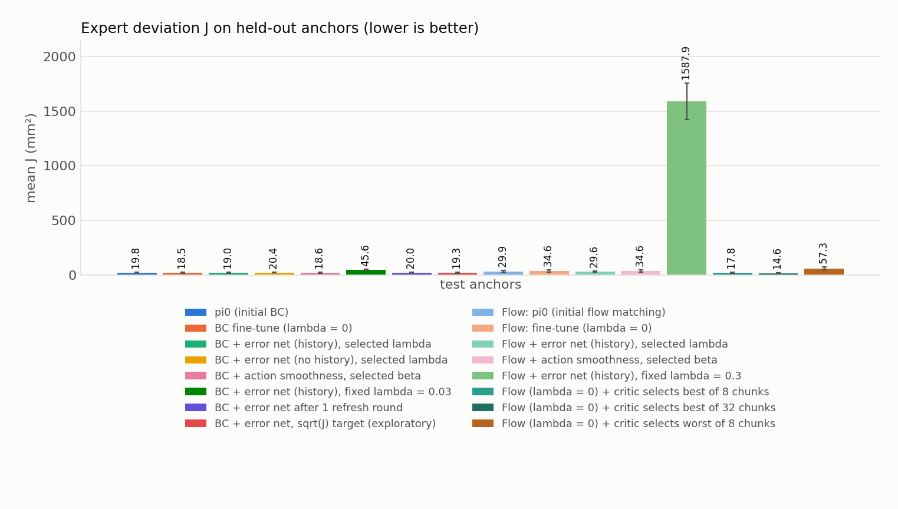
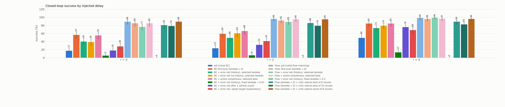
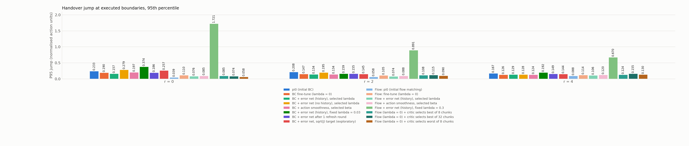

# Chunk Trajectory Error: ManiSkill PickCube-v1 results

Generated by `scripts/08_report.py`. Host: Linux-7.0.0-42-generic-x86_64-with-glibc2.39; Python 3.10.22; PyTorch 2.14.1+cu130 (CUDA available: True); ManiSkill 3.0.1; SAPIEN 3.0.3; simulation `physx_cpu`, one environment.

Chunk settings: H=20, e=5, L=15, K=10, train delay r=0. Seed 17. One training run per variant (no seed repeats).

## 1. Data and replay

- Demonstrations: 1000 episodes in the file, the first 600 used (`audit.num_episodes`), source `motionplanning`; split by episode into 400 / 100 / 100 (train / val / test).
- Replay audit (60 train anchors, tolerance 1 mm): `snapshot_restore_same_env` max 0.5386 mm (pass); `snapshot_restore_after_reset` max 0.5386 mm (pass); `hdf5_state_restore` max 0.5386 mm (pass); `prefix_replay` max 0.0033 mm (pass); `snapshot_branch_repeatability` max 0.0000 mm (pass); `control_shift_one_frame` max 13.9624 mm (pass).
- Branches, train: 1600 anchors, 12800 branches, 0 aborted, 0 candidates clipped at the action box. expert 1600 (median sqrt(J) 0.00 mm), expert_perturbed 3200 (median sqrt(J) 9.27 mm), policy 1600 (median sqrt(J) 3.10 mm), policy_perturbed 6400 (median sqrt(J) 10.42 mm).
- Branches, val: 300 anchors, 2400 branches, 0 aborted, 0 candidates clipped at the action box. expert 300 (median sqrt(J) 0.00 mm), expert_perturbed 600 (median sqrt(J) 8.68 mm), policy 300 (median sqrt(J) 3.64 mm), policy_perturbed 1200 (median sqrt(J) 10.76 mm).
- Branches, test: 300 anchors, 2400 branches, 0 aborted, 0 candidates clipped at the action box. expert 300 (median sqrt(J) 0.00 mm), expert_perturbed 600 (median sqrt(J) 10.27 mm), policy 300 (median sqrt(J) 3.51 mm), policy_perturbed 1200 (median sqrt(J) 10.63 mm).

## 2. Error network (held-out branches)

| Variant | Split | MAE (m²) | Constant-mean MAE (m²) | MAE of sqrt(J) (mm) | Pearson | Within-anchor Spearman | Best-candidate match |
|---|---|---:|---:|---:|---:|---:|---:|
| history | val | 7.599e-05 | 3.271e-04 | 3.19 | 0.963 | 0.861 | 0.50 |
| history | test | 7.166e-05 | 3.440e-04 | 2.98 | 0.973 | 0.892 | 0.53 |
| history_fullobs | val | 7.299e-05 | 3.271e-04 | 3.04 | 0.967 | 0.858 | 0.52 |
| history_fullobs | test | 7.020e-05 | 3.440e-04 | 2.84 | 0.973 | 0.893 | 0.63 |
| history_r1 | val | 7.228e-05 | 3.109e-04 | 3.00 | 0.964 | 0.864 | 0.56 |
| history_r1 | test | 6.908e-05 | 3.291e-04 | 2.86 | 0.973 | 0.896 | 0.59 |
| history_sqrt | val | 6.932e-05 | 3.271e-04 | 2.37 | 0.960 | 0.899 | 0.70 |
| history_sqrt | test | 6.935e-05 | 3.440e-04 | 2.31 | 0.967 | 0.922 | 0.71 |
| nohist | val | 9.140e-05 | 3.271e-04 | 3.51 | 0.946 | 0.824 | 0.45 |
| nohist | test | 8.881e-05 | 3.440e-04 | 3.47 | 0.959 | 0.847 | 0.47 |

Mean predicted vs. true J on test, by candidate type (m²): this shows the resolution of each network near J = 0.

| Variant | expert (true 0) predicted | policy true | policy predicted |
|---|---:|---:|---:|
| history | 3.60e-05 | 1.98e-05 | 4.32e-05 |
| history_fullobs | 3.18e-05 | 1.98e-05 | 3.84e-05 |
| history_r1 | 3.20e-05 | 1.98e-05 | 4.19e-05 |
| history_sqrt | 1.02e-05 | 1.98e-05 | 2.12e-05 |
| nohist | 3.87e-05 | 1.98e-05 | 4.54e-05 |

## 3. Gradient audit

- Parameter gradients from the surrogate alone: policy gradient norm 1.663e+01, finite True, non-zero True; error-network parameters without gradient True. Gate: pass.
- Step size: L2 norm over the K x 3 continuous action entries (normalised units), chosen on validation per candidate type from [0.02, 0.05, 0.1, 0.2, 0.4]; gripper channel masked.

| Test candidates | Step | n | Mean J before (m²) | ΔJ gradient step (m²) [95% CI] | ΔJ random step (m²) [95% CI] | Gradient − random (m²) [95% CI] | Relative ΔJ (gradient) | Gradient lowers J | Gate |
|---|---:|---:|---:|---:|---:|---:|---:|---:|---|
| policy | 0.02 | 300 | 1.978e-05 | -3.919e-06 [-4.67e-06, -3.18e-06] | 4.078e-07 [1.34e-07, 6.82e-07] | -4.327e-06 [-5.12e-06, -3.58e-06] | -19.8% | 76% | pass |
| policy_perturbed | 0.2 | 300 | 3.630e-04 | -1.738e-04 [-2.17e-04, -1.33e-04] | 3.504e-05 [1.94e-05, 4.91e-05] | -2.089e-04 [-2.51e-04, -1.67e-04] | -47.9% | 60% | pass |
| expert_perturbed | 0.2 | 300 | 3.759e-04 | -1.695e-04 [-2.16e-04, -1.26e-04] | 2.669e-05 [1.31e-05, 3.96e-05] | -1.962e-04 [-2.43e-04, -1.52e-04] | -45.1% | 56% | pass |

Validation, policy samples only (mean ΔJ of the gradient step / of the random step, m²): step 0.02: -4.24e-06 / 5.56e-07; step 0.05: -3.39e-06 / 2.58e-06; step 0.1: 1.71e-05 / 9.14e-06; step 0.2: 1.30e-04 / 3.41e-05; step 0.4: 6.44e-04 / 1.30e-04.

Direction gate (on test, at the step size chosen on val for that candidate type: 95% CI of delta_J_grad below 0 AND 95% CI of (grad - rand) below 0; the policy-sample row decides the gate): **pass**.

## 4. Policy fine-tuning

All variants start from the same pi0 and use the same data, batches, learning rate and 5000 update steps. The weight is chosen on validation by the simulator-recomputed J of the policy's own chunk.

Flow-matching policy class (`*_flow` rows): 633936 parameters, 8 Euler steps per chunk; pi0_flow best val flow-matching loss 0.0346, val MSE of one sampled chunk 0.01277 (MLP pi0 val BC loss 0.00743); pi0_flow val closed-loop r = 0: 29/30 (MLP pi0: 5/30). Flow variants start from pi0_flow; their imitation term is the flow-matching loss and the auxiliary term acts on a sampled chunk. `Val BC loss` for flow rows is the MSE of one sampled chunk.

| Variant | Weights tried (val mean J, m²) | Selected | Val BC loss | Grad-norm ratio auxiliary / imitation (last log) |
|---|---|---:|---:|---:|
| BC fine-tune (lambda = 0) | 0: 2.65e-05 | 0 | 0.00758 | 0.00 |
| BC + error net (history), selected lambda | 0.001: 2.58e-05, 0.003: 2.81e-05, 0.01: 3.73e-05, 0.03: 5.08e-05, 0.1: 1.01e-04, 0.3: 1.91e-04, 1: 3.96e-04 | 0.001 | 0.00761 | 0.35 |
| BC + error net (no history), selected lambda | 0.001: 2.73e-05, 0.003: 2.99e-05, 0.01: 3.73e-05, 0.03: 5.83e-05, 0.1: 1.48e-04, 0.3: 3.22e-04, 1: 7.38e-04 | 0.001 | 0.00760 | 0.29 |
| BC + action smoothness, selected beta | 0.1: 2.67e-05, 0.3: 2.72e-05, 1: 2.75e-05 | 0.1 | 0.00756 | 0.07 |
| BC + error net after 1 refresh round | 0.001: 2.83e-05, 0.003: 3.13e-05, 0.01: 3.81e-05, 0.03: 5.17e-05, 0.1: 8.60e-05, 0.3: 1.46e-04, 1: 2.66e-04 | 0.001 | 0.00761 | 0.46 |
| BC + error net, sqrt(J) target (exploratory) | 0.001: 2.58e-05, 0.003: 2.67e-05, 0.01: 2.95e-05, 0.03: 3.36e-05, 0.1: 4.26e-05, 0.3: 5.66e-05, 1: 1.07e-04 | 0.001 | 0.00760 | 0.30 |
| Flow: fine-tune (lambda = 0) | 0: 4.33e-05 | 0 | 0.01272 | 0.00 |
| Flow + error net (history), selected lambda | 0.001: 4.11e-05, 0.003: 3.93e-05, 0.01: 3.72e-05, 0.03: 3.91e-05, 0.1: 5.65e-05, 0.3: 1.61e-03, 1: 7.93e-03 | 0.01 | 0.01272 | 0.04 |
| Flow + action smoothness, selected beta | 0.1: 4.33e-05, 0.3: 4.34e-05, 1: 4.34e-05 | 0.1 | 0.01272 | 0.00 |

## 5. Expert deviation on held-out test anchors (r = 0)

J is recomputed in simulation: the policy's chunk tail and the expert's actions both start from the same restored state and run K steps.

| Policy | Mean J (m²) [95% CI] | Mean sqrt(J) (mm) | Paired ΔJ vs same-class fine-tune, lambda = 0 (m²) [95% CI] | Relative |
|---|---:|---:|---:|---:|
| pi0 (initial BC) | 1.979e-05 [1.69e-05, 2.32e-05] | 3.90 | 1.267e-06 [-5.53e-07, 3.03e-06] | +6.8% |
| BC fine-tune (lambda = 0) | 1.853e-05 [1.52e-05, 2.27e-05] | 3.65 | – | – |
| BC + error net (history), selected lambda | 1.903e-05 [1.58e-05, 2.30e-05] | 3.71 | 5.026e-07 [-9.12e-07, 1.84e-06] | +2.7% |
| BC + error net (no history), selected lambda | 2.036e-05 [1.69e-05, 2.45e-05] | 3.83 | 1.837e-06 [8.80e-07, 2.90e-06] | +9.9% |
| BC + action smoothness, selected beta | 1.863e-05 [1.53e-05, 2.27e-05] | 3.64 | 9.825e-08 [-1.45e-07, 3.24e-07] | +0.5% |
| BC + error net (history), fixed lambda = 0.03 | 4.562e-05 [3.96e-05, 5.27e-05] | 5.93 | 2.709e-05 [2.24e-05, 3.21e-05] | +146.2% |
| BC + error net after 1 refresh round | 1.995e-05 [1.68e-05, 2.37e-05] | 3.83 | 1.423e-06 [-4.09e-08, 2.90e-06] | +7.7% |
| BC + error net, sqrt(J) target (exploratory) | 1.926e-05 [1.60e-05, 2.32e-05] | 3.71 | 7.341e-07 [-5.35e-07, 1.89e-06] | +4.0% |
| Flow: pi0 (initial flow matching) | 2.985e-05 [2.20e-05, 3.95e-05] | 3.89 | -4.740e-06 [-6.15e-06, -3.43e-06] | -13.7% |
| Flow: fine-tune (lambda = 0) | 3.459e-05 [2.65e-05, 4.46e-05] | 4.51 | – | – |
| Flow + error net (history), selected lambda | 2.957e-05 [2.37e-05, 3.63e-05] | 4.30 | -5.020e-06 [-8.87e-06, -2.09e-06] | -14.5% |
| Flow + action smoothness, selected beta | 3.460e-05 [2.65e-05, 4.46e-05] | 4.51 | 9.428e-09 [-1.36e-08, 3.17e-08] | +0.0% |
| Flow + error net (history), fixed lambda = 0.3 | 1.588e-03 [1.42e-03, 1.76e-03] | 34.54 | 1.569e-03 [1.40e-03, 1.74e-03] | +8470.5% |
| Flow (lambda = 0) + critic selects best of 8 chunks | 1.775e-05 [1.43e-05, 2.26e-05] | 3.50 | -1.684e-05 [-2.33e-05, -1.13e-05] | -48.7% |
| Flow (lambda = 0) + critic selects best of 32 chunks | 1.464e-05 [1.23e-05, 1.74e-05] | 3.28 | -1.995e-05 [-2.84e-05, -1.28e-05] | -57.7% |
| Flow (lambda = 0) + critic selects worst of 8 chunks | 5.726e-05 [4.49e-05, 7.21e-05] | 5.72 | 2.266e-05 [1.63e-05, 2.94e-05] | +65.5% |

300 anchors from 100 test episodes; intervals resample episodes.

## 6. Closed loop

150 initial states per condition ({'test_episode': 100, 'fresh_seed': 50}); identical states and scheduler for every policy; episode limit 200 steps; success is the environment's own flag. r is an injected scheduling delay; policies were trained at r = 0 only.

### Success

| Policy | r = 0 | r = 2 | r = 4 |
|---|---:|---:|---:|
| pi0 (initial BC) | 26/150 (17%) [12%, 24%] | 35/150 (23%) [17%, 31%] | 74/150 (49%) [41%, 57%] |
| BC fine-tune (lambda = 0) | 85/150 (57%) [49%, 64%] | 89/150 (59%) [51%, 67%] | 127/150 (85%) [78%, 90%] |
| BC + error net (history), selected lambda | 60/150 (40%) [33%, 48%] | 74/150 (49%) [41%, 57%] | 110/150 (73%) [66%, 80%] |
| BC + error net (no history), selected lambda | 58/150 (39%) [31%, 47%] | 91/150 (61%) [53%, 68%] | 119/150 (79%) [72%, 85%] |
| BC + action smoothness, selected beta | 83/150 (55%) [47%, 63%] | 99/150 (66%) [58%, 73%] | 127/150 (85%) [78%, 90%] |
| BC + error net (history), fixed lambda = 0.03 | 8/150 (5%) [3%, 10%] | 9/150 (6%) [3%, 11%] | 20/150 (13%) [9%, 20%] |
| BC + error net after 1 refresh round | 27/150 (18%) [13%, 25%] | 48/150 (32%) [25%, 40%] | 114/150 (76%) [69%, 82%] |
| BC + error net, sqrt(J) target (exploratory) | 42/150 (28%) [21%, 36%] | 62/150 (41%) [34%, 49%] | 103/150 (69%) [61%, 76%] |
| Flow: pi0 (initial flow matching) | 134/150 (89%) [83%, 93%] | 144/150 (96%) [92%, 98%] | 148/150 (99%) [95%, 100%] |
| Flow: fine-tune (lambda = 0) | 128/150 (85%) [79%, 90%] | 138/150 (92%) [87%, 95%] | 144/150 (96%) [92%, 98%] |
| Flow + error net (history), selected lambda | 115/150 (77%) [69%, 83%] | 133/150 (89%) [83%, 93%] | 149/150 (99%) [96%, 100%] |
| Flow + action smoothness, selected beta | 128/150 (85%) [79%, 90%] | 143/150 (95%) [91%, 98%] | 145/150 (97%) [92%, 99%] |
| Flow + error net (history), fixed lambda = 0.3 | 0/150 (0%) [0%, 2%] | 0/150 (0%) [0%, 2%] | 0/150 (0%) [0%, 2%] |
| Flow (lambda = 0) + critic selects best of 8 chunks | 121/150 (81%) [74%, 86%] | 129/150 (86%) [80%, 91%] | 134/150 (89%) [83%, 93%] |
| Flow (lambda = 0) + critic selects best of 32 chunks | 118/150 (79%) [71%, 84%] | 119/150 (79%) [72%, 85%] | 124/150 (83%) [76%, 88%] |
| Flow (lambda = 0) + critic selects worst of 8 chunks | 134/150 (89%) [83%, 93%] | 143/150 (95%) [91%, 98%] | 144/150 (96%) [92%, 98%] |

Brackets are Wilson 95% intervals.

Paired comparison with the same-class fine-tune at lambda = 0 (same initial states); MLP variants against `bc`, flow variants against `bc_flow`:

| Policy | Delay | Success difference (pp) [95% CI] | Only this policy succeeds | Only reference succeeds | McNemar exact p |
|---|---:|---:|---:|---:|---:|
| pi0 (initial BC) | 0 | -39.3 [-48.7, -30.0] | 8 | 67 | 0.000 |
| pi0 (initial BC) | 2 | -36.0 [-45.3, -26.0] | 10 | 64 | 0.000 |
| pi0 (initial BC) | 4 | -35.3 [-44.0, -26.7] | 6 | 59 | 0.000 |
| pi0 (initial BC) | all | -36.9 [-43.3, -30.4] | 24 | 190 | 0.000 |
| BC + error net (history), selected lambda | 0 | -16.7 [-26.0, -7.3] | 14 | 39 | 0.001 |
| BC + error net (history), selected lambda | 2 | -10.0 [-17.3, -2.7] | 8 | 23 | 0.011 |
| BC + error net (history), selected lambda | 4 | -11.3 [-17.3, -5.3] | 4 | 21 | 0.001 |
| BC + error net (history), selected lambda | all | -12.7 [-17.6, -8.0] | 26 | 83 | 0.000 |
| BC + error net (no history), selected lambda | 0 | -18.0 [-26.7, -9.3] | 11 | 38 | 0.000 |
| BC + error net (no history), selected lambda | 2 | +1.3 [-5.3, +8.0] | 14 | 12 | 0.845 |
| BC + error net (no history), selected lambda | 4 | -5.3 [-11.3, +0.7] | 7 | 15 | 0.134 |
| BC + error net (no history), selected lambda | all | -7.3 [-11.3, -3.1] | 32 | 65 | 0.001 |
| BC + action smoothness, selected beta | 0 | -1.3 [-8.0, +5.3] | 12 | 14 | 0.845 |
| BC + action smoothness, selected beta | 2 | +6.7 [+1.3, +12.7] | 15 | 5 | 0.041 |
| BC + action smoothness, selected beta | 4 | +0.0 [-4.0, +4.0] | 5 | 5 | 1.000 |
| BC + action smoothness, selected beta | all | +1.8 [-1.8, +5.3] | 32 | 24 | 0.350 |
| BC + error net (history), fixed lambda = 0.03 | 0 | -51.3 [-60.0, -42.7] | 3 | 80 | 0.000 |
| BC + error net (history), fixed lambda = 0.03 | 2 | -53.3 [-61.3, -45.3] | 2 | 82 | 0.000 |
| BC + error net (history), fixed lambda = 0.03 | 4 | -71.3 [-78.7, -64.0] | 0 | 107 | 0.000 |
| BC + error net (history), fixed lambda = 0.03 | all | -58.7 [-64.4, -52.7] | 5 | 269 | 0.000 |
| BC + error net after 1 refresh round | 0 | -38.7 [-46.7, -30.7] | 2 | 60 | 0.000 |
| BC + error net after 1 refresh round | 2 | -27.3 [-36.7, -18.0] | 9 | 50 | 0.000 |
| BC + error net after 1 refresh round | 4 | -8.7 [-15.3, -2.0] | 8 | 21 | 0.024 |
| BC + error net after 1 refresh round | all | -24.9 [-30.0, -19.8] | 19 | 131 | 0.000 |
| BC + error net, sqrt(J) target (exploratory) | 0 | -28.7 [-38.0, -20.0] | 9 | 52 | 0.000 |
| BC + error net, sqrt(J) target (exploratory) | 2 | -18.0 [-26.0, -10.0] | 8 | 35 | 0.000 |
| BC + error net, sqrt(J) target (exploratory) | 4 | -16.0 [-23.3, -8.7] | 5 | 29 | 0.000 |
| BC + error net, sqrt(J) target (exploratory) | all | -20.9 [-26.2, -15.8] | 22 | 116 | 0.000 |
| Flow: pi0 (initial flow matching) | 0 | +4.0 [-2.7, +10.7] | 15 | 9 | 0.307 |
| Flow: pi0 (initial flow matching) | 2 | +4.0 [-1.3, +9.3] | 12 | 6 | 0.238 |
| Flow: pi0 (initial flow matching) | 4 | +2.7 [-0.7, +6.7] | 6 | 2 | 0.289 |
| Flow: pi0 (initial flow matching) | all | +3.6 [+0.0, +7.1] | 33 | 17 | 0.033 |
| Flow + error net (history), selected lambda | 0 | -8.7 [-16.0, -2.0] | 9 | 22 | 0.029 |
| Flow + error net (history), selected lambda | 2 | -3.3 [-10.0, +2.7] | 9 | 14 | 0.405 |
| Flow + error net (history), selected lambda | 4 | +3.3 [+0.0, +6.7] | 6 | 1 | 0.125 |
| Flow + error net (history), selected lambda | all | -2.9 [-6.4, +0.4] | 24 | 37 | 0.124 |
| Flow + action smoothness, selected beta | 0 | +0.0 [-6.0, +6.0] | 11 | 11 | 1.000 |
| Flow + action smoothness, selected beta | 2 | +3.3 [-0.7, +8.0] | 8 | 3 | 0.227 |
| Flow + action smoothness, selected beta | 4 | +0.7 [-1.3, +2.7] | 2 | 1 | 1.000 |
| Flow + action smoothness, selected beta | all | +1.3 [-1.1, +4.0] | 21 | 15 | 0.405 |
| Flow + error net (history), fixed lambda = 0.3 | 0 | -56.7 [-64.7, -48.7] | 0 | 85 | 0.000 |
| Flow + error net (history), fixed lambda = 0.3 | 2 | -59.3 [-67.3, -51.3] | 0 | 89 | 0.000 |
| Flow + error net (history), fixed lambda = 0.3 | 4 | -84.7 [-90.0, -78.7] | 0 | 127 | 0.000 |
| Flow + error net (history), fixed lambda = 0.3 | all | -66.9 [-72.4, -61.1] | 0 | 301 | 0.000 |
| Flow (lambda = 0) + critic selects best of 8 chunks | 0 | -4.7 [-10.7, +2.0] | 8 | 15 | 0.210 |
| Flow (lambda = 0) + critic selects best of 8 chunks | 2 | -6.0 [-12.0, +0.0] | 6 | 15 | 0.078 |
| Flow (lambda = 0) + critic selects best of 8 chunks | 4 | -6.7 [-12.0, -2.0] | 3 | 13 | 0.021 |
| Flow (lambda = 0) + critic selects best of 8 chunks | all | -5.8 [-8.9, -2.9] | 17 | 43 | 0.001 |
| Flow (lambda = 0) + critic selects best of 32 chunks | 0 | -6.7 [-13.3, +0.0] | 9 | 19 | 0.087 |
| Flow (lambda = 0) + critic selects best of 32 chunks | 2 | -12.7 [-20.0, -5.3] | 6 | 25 | 0.001 |
| Flow (lambda = 0) + critic selects best of 32 chunks | 4 | -13.3 [-20.0, -7.3] | 4 | 24 | 0.000 |
| Flow (lambda = 0) + critic selects best of 32 chunks | all | -10.9 [-14.7, -7.3] | 19 | 68 | 0.000 |
| Flow (lambda = 0) + critic selects worst of 8 chunks | 0 | +4.0 [-2.0, +10.0] | 14 | 8 | 0.286 |
| Flow (lambda = 0) + critic selects worst of 8 chunks | 2 | +3.3 [-0.7, +7.3] | 7 | 2 | 0.180 |
| Flow (lambda = 0) + critic selects worst of 8 chunks | 4 | +0.0 [-4.7, +4.7] | 6 | 6 | 1.000 |
| Flow (lambda = 0) + critic selects worst of 8 chunks | all | +2.4 [-0.2, +5.1] | 27 | 16 | 0.126 |

### Handover jump at executed boundaries

Jump = ||u_b − u_{b−1}||₂ on the three translation channels of the executed, normalised command (PickCube has no rotation channel); gripper reported separately.

| Policy | Delay | Boundaries | Median jump | P95 jump | Median within-chunk step change | Gripper jump > 0 | Mean EE step (mm) | Mean episode steps |
|---|---:|---:|---:|---:|---:|---:|---:|---:|
| pi0 (initial BC) | 0 | 5390 | 0.0308 | 0.2334 | 0.0269 | 89.0% | 3.50 | 184.3 |
| pi0 (initial BC) | 2 | 5228 | 0.0371 | 0.2079 | 0.0208 | 85.6% | 3.21 | 178.8 |
| pi0 (initial BC) | 4 | 4383 | 0.0435 | 0.1671 | 0.0183 | 78.3% | 3.67 | 150.0 |
| BC fine-tune (lambda = 0) | 0 | 3946 | 0.0245 | 0.1903 | 0.0181 | 88.8% | 4.10 | 135.4 |
| BC fine-tune (lambda = 0) | 2 | 3774 | 0.0261 | 0.1474 | 0.0177 | 90.5% | 3.92 | 129.6 |
| BC fine-tune (lambda = 0) | 4 | 2751 | 0.0309 | 0.1261 | 0.0189 | 82.8% | 4.71 | 95.0 |
| BC + error net (history), selected lambda | 0 | 4562 | 0.0333 | 0.1575 | 0.0203 | 88.6% | 3.83 | 156.4 |
| BC + error net (history), selected lambda | 2 | 4170 | 0.0316 | 0.1343 | 0.0192 | 88.6% | 3.82 | 143.2 |
| BC + error net (history), selected lambda | 4 | 3317 | 0.0348 | 0.1290 | 0.0194 | 86.6% | 4.20 | 114.3 |
| BC + error net (no history), selected lambda | 0 | 4613 | 0.0309 | 0.2789 | 0.0227 | 89.1% | 3.93 | 158.1 |
| BC + error net (no history), selected lambda | 2 | 3798 | 0.0308 | 0.1955 | 0.0205 | 89.5% | 4.21 | 130.4 |
| BC + error net (no history), selected lambda | 4 | 3010 | 0.0337 | 0.1285 | 0.0198 | 84.0% | 4.51 | 104.0 |
| BC + action smoothness, selected beta | 0 | 3906 | 0.0250 | 0.1971 | 0.0174 | 87.8% | 4.24 | 134.1 |
| BC + action smoothness, selected beta | 2 | 3513 | 0.0266 | 0.1338 | 0.0181 | 91.3% | 4.12 | 120.8 |
| BC + action smoothness, selected beta | 4 | 2794 | 0.0317 | 0.1241 | 0.0187 | 82.6% | 4.64 | 96.7 |
| BC + error net (history), fixed lambda = 0.03 | 0 | 5682 | 0.0715 | 0.3742 | 0.0532 | 93.3% | 4.31 | 194.3 |
| BC + error net (history), fixed lambda = 0.03 | 2 | 5650 | 0.0607 | 0.1587 | 0.0446 | 96.6% | 3.16 | 193.2 |
| BC + error net (history), fixed lambda = 0.03 | 4 | 5456 | 0.0566 | 0.1922 | 0.0442 | 95.8% | 3.27 | 186.6 |
| BC + error net after 1 refresh round | 0 | 5254 | 0.0329 | 0.1864 | 0.0283 | 89.5% | 3.53 | 179.7 |
| BC + error net after 1 refresh round | 2 | 4801 | 0.0346 | 0.1547 | 0.0249 | 92.2% | 3.51 | 164.4 |
| BC + error net after 1 refresh round | 4 | 3120 | 0.0435 | 0.1492 | 0.0210 | 85.6% | 4.45 | 107.8 |
| BC + error net, sqrt(J) target (exploratory) | 0 | 5019 | 0.0338 | 0.2568 | 0.0226 | 89.3% | 3.80 | 171.7 |
| BC + error net, sqrt(J) target (exploratory) | 2 | 4431 | 0.0322 | 0.1450 | 0.0191 | 91.0% | 3.67 | 152.0 |
| BC + error net, sqrt(J) target (exploratory) | 4 | 3454 | 0.0406 | 0.1445 | 0.0183 | 86.1% | 4.27 | 118.8 |
| Flow: pi0 (initial flow matching) | 0 | 2558 | 0.0192 | 0.0390 | 0.0210 | 63.2% | 4.68 | 88.5 |
| Flow: pi0 (initial flow matching) | 2 | 2300 | 0.0273 | 0.0579 | 0.0217 | 72.0% | 4.82 | 79.9 |
| Flow: pi0 (initial flow matching) | 4 | 2176 | 0.0309 | 0.0879 | 0.0215 | 81.9% | 4.90 | 75.6 |
| Flow: fine-tune (lambda = 0) | 0 | 2689 | 0.0316 | 0.1099 | 0.0280 | 71.4% | 4.94 | 92.8 |
| Flow: fine-tune (lambda = 0) | 2 | 2497 | 0.0359 | 0.1052 | 0.0290 | 69.2% | 5.00 | 86.7 |
| Flow: fine-tune (lambda = 0) | 4 | 2404 | 0.0451 | 0.1139 | 0.0270 | 84.0% | 4.90 | 83.5 |
| Flow + error net (history), selected lambda | 0 | 3064 | 0.0312 | 0.0755 | 0.0301 | 69.7% | 4.60 | 105.5 |
| Flow + error net (history), selected lambda | 2 | 2644 | 0.0353 | 0.0742 | 0.0319 | 78.6% | 4.67 | 91.3 |
| Flow + error net (history), selected lambda | 4 | 2177 | 0.0432 | 0.1059 | 0.0308 | 93.2% | 5.02 | 75.6 |
| Flow + action smoothness, selected beta | 0 | 2768 | 0.0309 | 0.0854 | 0.0278 | 72.9% | 4.84 | 95.6 |
| Flow + action smoothness, selected beta | 2 | 2401 | 0.0350 | 0.0882 | 0.0288 | 68.6% | 4.95 | 83.2 |
| Flow + action smoothness, selected beta | 4 | 2412 | 0.0456 | 0.1197 | 0.0270 | 85.4% | 4.87 | 83.5 |
| Flow + error net (history), fixed lambda = 0.3 | 0 | 5850 | 0.3154 | 1.7208 | 0.2883 | 67.9% | 16.79 | 200.0 |
| Flow + error net (history), fixed lambda = 0.3 | 2 | 5850 | 0.2809 | 0.8909 | 0.1822 | 79.7% | 9.97 | 200.0 |
| Flow + error net (history), fixed lambda = 0.3 | 4 | 5850 | 0.2663 | 0.6697 | 0.1806 | 93.0% | 8.54 | 200.0 |
| Flow (lambda = 0) + critic selects best of 8 chunks | 0 | 3254 | 0.0287 | 0.0855 | 0.0272 | 71.9% | 4.43 | 111.7 |
| Flow (lambda = 0) + critic selects best of 8 chunks | 2 | 3005 | 0.0353 | 0.1081 | 0.0282 | 70.2% | 4.42 | 103.5 |
| Flow (lambda = 0) + critic selects best of 8 chunks | 4 | 2912 | 0.0444 | 0.1243 | 0.0265 | 85.0% | 4.31 | 100.3 |
| Flow (lambda = 0) + critic selects best of 32 chunks | 0 | 3456 | 0.0284 | 0.0744 | 0.0273 | 68.8% | 4.18 | 118.7 |
| Flow (lambda = 0) + critic selects best of 32 chunks | 2 | 3358 | 0.0358 | 0.1154 | 0.0281 | 66.1% | 4.30 | 115.4 |
| Flow (lambda = 0) + critic selects best of 32 chunks | 4 | 3236 | 0.0458 | 0.1547 | 0.0264 | 87.2% | 4.01 | 111.3 |
| Flow (lambda = 0) + critic selects worst of 8 chunks | 0 | 2472 | 0.0319 | 0.0581 | 0.0285 | 66.3% | 5.29 | 85.6 |
| Flow (lambda = 0) + critic selects worst of 8 chunks | 2 | 2216 | 0.0367 | 0.0903 | 0.0296 | 70.2% | 5.31 | 76.9 |
| Flow (lambda = 0) + critic selects worst of 8 chunks | 4 | 2294 | 0.0486 | 0.1297 | 0.0287 | 81.2% | 5.18 | 79.7 |

Paired per-episode mean jump versus the same-class fine-tune at lambda = 0 (same initial state and delay):

| Policy | Delay | Difference in mean jump [95% CI] | Relative |
|---|---:|---:|---:|
| pi0 (initial BC) | 0 | +0.0171 [+0.0069, +0.0272] | +40.7% |
| pi0 (initial BC) | 2 | +0.0195 [+0.0138, +0.0254] | +51.5% |
| pi0 (initial BC) | 4 | +0.0201 [+0.0127, +0.0287] | +49.3% |
| BC + error net (history), selected lambda | 0 | +0.0066 [-0.0021, +0.0158] | +15.7% |
| BC + error net (history), selected lambda | 2 | +0.0109 [+0.0014, +0.0250] | +28.8% |
| BC + error net (history), selected lambda | 4 | +0.0025 [-0.0004, +0.0057] | +6.2% |
| BC + error net (no history), selected lambda | 0 | +0.0319 [+0.0126, +0.0549] | +75.8% |
| BC + error net (no history), selected lambda | 2 | +0.0083 [+0.0019, +0.0158] | +21.9% |
| BC + error net (no history), selected lambda | 4 | +0.0019 [-0.0011, +0.0050] | +4.7% |
| BC + action smoothness, selected beta | 0 | +0.0041 [-0.0076, +0.0212] | +9.7% |
| BC + action smoothness, selected beta | 2 | -0.0008 [-0.0034, +0.0016] | -2.2% |
| BC + action smoothness, selected beta | 4 | -0.0001 [-0.0019, +0.0014] | -0.3% |
| BC + error net (history), fixed lambda = 0.03 | 0 | +0.0865 [+0.0664, +0.1091] | +205.4% |
| BC + error net (history), fixed lambda = 0.03 | 2 | +0.0344 [+0.0285, +0.0400] | +91.1% |
| BC + error net (history), fixed lambda = 0.03 | 4 | +0.0391 [+0.0278, +0.0551] | +96.2% |
| BC + error net after 1 refresh round | 0 | +0.0132 [+0.0037, +0.0230] | +31.3% |
| BC + error net after 1 refresh round | 2 | +0.0115 [+0.0066, +0.0165] | +30.3% |
| BC + error net after 1 refresh round | 4 | +0.0162 [+0.0108, +0.0230] | +39.7% |
| BC + error net, sqrt(J) target (exploratory) | 0 | +0.0298 [+0.0141, +0.0485] | +70.9% |
| BC + error net, sqrt(J) target (exploratory) | 2 | +0.0089 [+0.0033, +0.0153] | +23.7% |
| BC + error net, sqrt(J) target (exploratory) | 4 | +0.0093 [+0.0052, +0.0132] | +22.8% |
| Flow: pi0 (initial flow matching) | 0 | -0.0160 [-0.0217, -0.0120] | -42.6% |
| Flow: pi0 (initial flow matching) | 2 | -0.0110 [-0.0130, -0.0091] | -26.8% |
| Flow: pi0 (initial flow matching) | 4 | -0.0151 [-0.0179, -0.0128] | -29.0% |
| Flow + error net (history), selected lambda | 0 | +0.0001 [-0.0062, +0.0063] | +0.4% |
| Flow + error net (history), selected lambda | 2 | -0.0017 [-0.0040, +0.0005] | -4.0% |
| Flow + error net (history), selected lambda | 4 | -0.0022 [-0.0040, -0.0005] | -4.3% |
| Flow + action smoothness, selected beta | 0 | +0.0007 [-0.0059, +0.0097] | +1.9% |
| Flow + action smoothness, selected beta | 2 | -0.0015 [-0.0034, +0.0002] | -3.7% |
| Flow + action smoothness, selected beta | 4 | -0.0001 [-0.0023, +0.0017] | -0.1% |
| Flow + error net (history), fixed lambda = 0.3 | 0 | +0.4811 [+0.4454, +0.5178] | +1142.0% |
| Flow + error net (history), fixed lambda = 0.3 | 2 | +0.3144 [+0.2934, +0.3368] | +831.4% |
| Flow + error net (history), fixed lambda = 0.3 | 4 | +0.2747 [+0.2525, +0.2995] | +674.8% |
| Flow (lambda = 0) + critic selects best of 8 chunks | 0 | -0.0025 [-0.0081, +0.0015] | -6.7% |
| Flow (lambda = 0) + critic selects best of 8 chunks | 2 | +0.0011 [-0.0023, +0.0057] | +2.6% |
| Flow (lambda = 0) + critic selects best of 8 chunks | 4 | -0.0009 [-0.0040, +0.0022] | -1.7% |
| Flow (lambda = 0) + critic selects best of 32 chunks | 0 | -0.0029 [-0.0080, +0.0013] | -7.8% |
| Flow (lambda = 0) + critic selects best of 32 chunks | 2 | +0.0053 [-0.0004, +0.0147] | +12.9% |
| Flow (lambda = 0) + critic selects best of 32 chunks | 4 | +0.0024 [-0.0012, +0.0061] | +4.6% |
| Flow (lambda = 0) + critic selects worst of 8 chunks | 0 | -0.0018 [-0.0073, +0.0028] | -4.7% |
| Flow (lambda = 0) + critic selects worst of 8 chunks | 2 | +0.0004 [-0.0013, +0.0019] | +1.0% |
| Flow (lambda = 0) + critic selects worst of 8 chunks | 4 | +0.0045 [+0.0013, +0.0078] | +8.7% |

## 7. Deployment path and latency

Evaluation loads policy checkpoints only (weights plus observation normalisation); no error network, expert history or extra sampling is on the inference path.

| Policy | Device | p50 (ms) | p95 (ms) |
|---|---|---:|---:|
| BC fine-tune (lambda = 0) | cpu (1 thread) | 0.040 | 0.043 |
| BC + error net (history), selected lambda | cpu (1 thread) | 0.037 | 0.039 |
| BC + error net after 1 refresh round | cpu (1 thread) | 0.033 | 0.036 |
| BC + error net, sqrt(J) target (exploratory) | cpu (1 thread) | 0.025 | 0.025 |
| BC + error net (history), fixed lambda = 0.03 | cpu (1 thread) | 0.028 | 0.031 |
| Flow: pi0 (initial flow matching) | cpu (1 thread) | 0.521 | 0.574 |
| Flow: fine-tune (lambda = 0) | cpu (1 thread) | 0.514 | 0.565 |
| Flow + error net (history), selected lambda | cpu (1 thread) | 0.514 | 0.580 |
| Flow + action smoothness, selected beta | cpu (1 thread) | 0.508 | 0.595 |
| Flow + error net (history), fixed lambda = 0.3 | cpu (1 thread) | 0.519 | 0.543 |
| BC + error net (no history), selected lambda | cpu (1 thread) | 0.036 | 0.038 |
| pi0 (initial BC) | cpu (1 thread) | 0.030 | 0.032 |
| Flow (lambda = 0) + critic selects best of 8 chunks | cpu (1 thread) | 1.481 | 1.726 |
| Flow (lambda = 0) + critic selects worst of 8 chunks | cpu (1 thread) | 1.474 | 1.575 |
| Flow (lambda = 0) + critic selects best of 32 chunks | cpu (1 thread) | 3.213 | 3.466 |
| BC + action smoothness, selected beta | cpu (1 thread) | 0.044 | 0.048 |

Single chunk, batch 1, after 200 warm-up calls. This is measured forward time and is unrelated to the injected delay r.

## 8. Acceptance check against the same-class fine-tune (lambda = 0)

Rule from the specification: a closed-loop improvement is claimed only if held-out J and handover jump both improve and the success evidence supports no loss. "Improves" below means the paired 95% interval excludes zero in the favourable direction.

| Policy | Held-out J | Handover jump (delays pooled) | Success (delays pooled) | Conclusion |
|---|---|---|---|---|
| BC + error net (history), selected lambda | no detectable change (+2.7%) | worse (+16.6%) | worse (-12.7 pp [-17.6, -8.0]) | worse than bc fine-tune |
| BC + error net (no history), selected lambda | worse (+9.9%) | worse (+34.9%) | worse (-7.3 pp [-11.3, -3.1]) | worse than bc fine-tune |
| BC + action smoothness, selected beta | no detectable change (+0.5%) | no detectable change (+2.6%) | no detectable change (+1.8 pp [-1.8, +5.3]) | no supported improvement |
| BC + error net (history), fixed lambda = 0.03 | worse (+146.2%) | worse (+132.7%) | worse (-58.7 pp [-64.4, -52.7]) | worse than bc fine-tune |
| BC + error net after 1 refresh round | no detectable change (+7.7%) | worse (+33.8%) | worse (-24.9 pp [-30.0, -19.8]) | worse than bc fine-tune |
| BC + error net, sqrt(J) target (exploratory) | no detectable change (+4.0%) | worse (+39.8%) | worse (-20.9 pp [-26.2, -15.8]) | worse than bc fine-tune |
| Flow + error net (history), selected lambda | improves (-14.5%) | no detectable change (-2.9%) | no detectable change (-2.9 pp [-6.4, +0.4]) | changes trajectory deviation only; no evidence on handover |
| Flow + action smoothness, selected beta | no detectable change (+0.0%) | no detectable change (-0.6%) | no detectable change (+1.3 pp [-1.1, +4.0]) | no supported improvement |
| Flow + error net (history), fixed lambda = 0.3 | worse (+8470.5%) | worse (+887.0%) | worse (-66.9 pp [-72.4, -61.1]) | worse than bc fine-tune |
| Flow (lambda = 0) + critic selects best of 8 chunks | improves (-48.7%) | no detectable change (-1.8%) | worse (-5.8 pp [-8.9, -2.9]) | changes trajectory deviation only; no evidence on handover |
| Flow (lambda = 0) + critic selects best of 32 chunks | improves (-57.7%) | no detectable change (+3.7%) | worse (-10.9 pp [-14.7, -7.3]) | changes trajectory deviation only; no evidence on handover |

## 9. Validation sweeps for every trained variant

Simulator-recomputed mean J of the policy chunk on validation anchors (m²); BC fine-tune is the lambda = 0 reference.

| Run | Weight: val mean J |
|---|---|
| bc | 0: 2.65e-05 |
| bc_flow | 0: 4.33e-05 |
| error | 0.001: 2.58e-05, 0.003: 2.81e-05, 0.01: 3.73e-05, 0.03: 5.08e-05, 0.1: 1.01e-04, 0.3: 1.91e-04, 1: 3.96e-04 |
| error_flow | 0.001: 4.11e-05, 0.003: 3.93e-05, 0.01: 3.72e-05, 0.03: 3.91e-05, 0.1: 5.65e-05, 0.3: 1.61e-03, 1: 7.93e-03 |
| error_fullobs | 0.001: 2.95e-05, 0.003: 3.42e-05, 0.01: 4.47e-05, 0.03: 7.08e-05, 0.1: 1.19e-04, 0.3: 2.12e-04, 1: 3.96e-04 |
| error_r1 | 0.001: 2.83e-05, 0.003: 3.13e-05, 0.01: 3.81e-05, 0.03: 5.17e-05, 0.1: 8.60e-05, 0.3: 1.46e-04, 1: 2.66e-04 |
| error_sqrt | 0.001: 2.58e-05, 0.003: 2.67e-05, 0.01: 2.95e-05, 0.03: 3.36e-05, 0.1: 4.26e-05, 0.3: 5.66e-05, 1: 1.07e-04 |
| nohist | 0.001: 2.73e-05, 0.003: 2.99e-05, 0.01: 3.73e-05, 0.03: 5.83e-05, 0.1: 1.48e-04, 0.3: 3.22e-04, 1: 7.38e-04 |
| smooth | 0.1: 2.67e-05, 0.3: 2.72e-05, 1: 2.75e-05 |
| smooth_flow | 0.1: 4.33e-05, 0.3: 4.34e-05, 1: 4.34e-05 |
